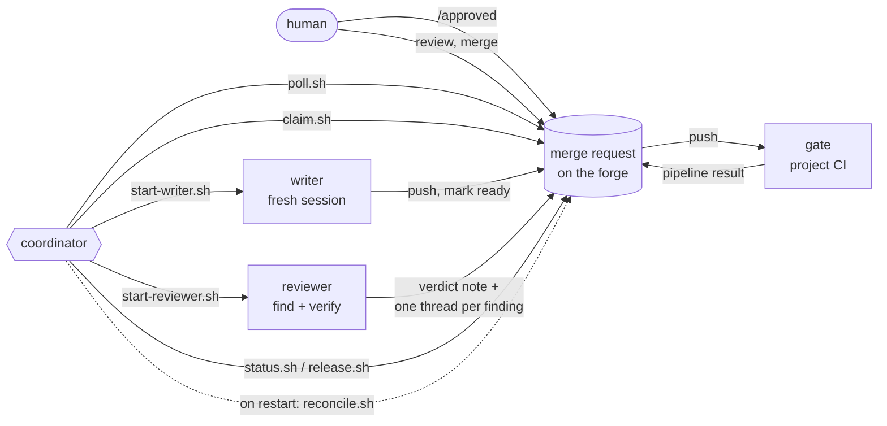
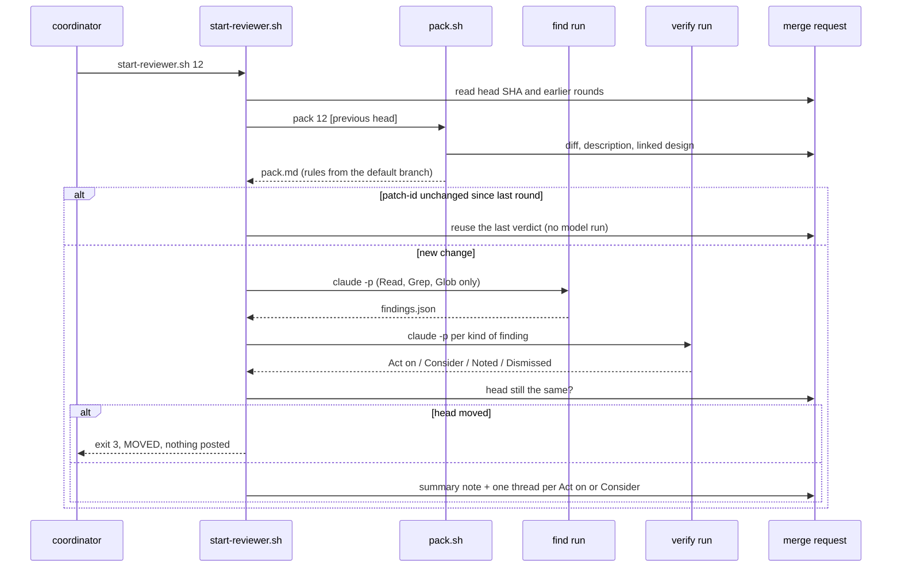
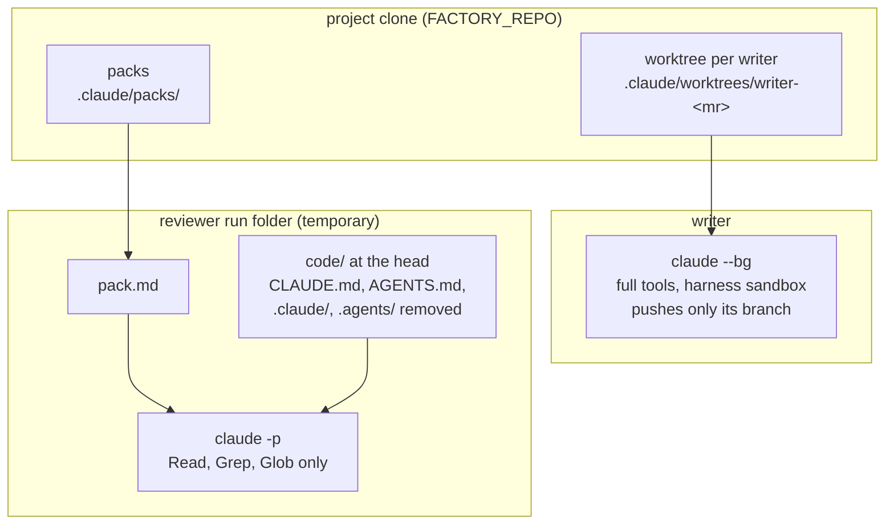
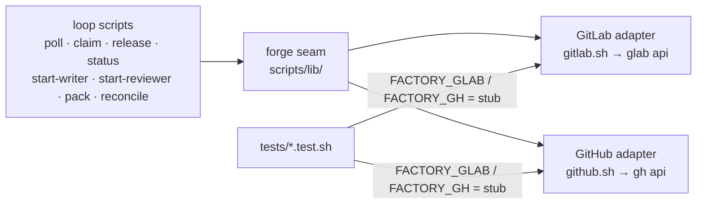
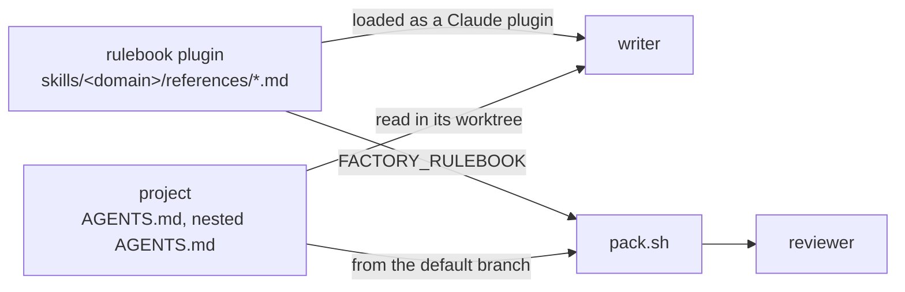

# Architecture

The agent factory turns an approved merge request into a reviewed, gate-green change that a human merges. One
coordinator AI runs the loop. Fresh workers do the writing and the reviewing. The forge (today GitLab) holds all
state. Words in **bold** are defined in [GLOSSARY.md](GLOSSARY.md).

## The parts

| part | what it is | where it lives |
|---|---|---|
| **Coordinator** | one AI session the human talks to; it polls the forge, decides, and calls the scripts | [docs/playbooks/coordinator.md](docs/playbooks/coordinator.md) (its instructions) |
| loop scripts | small deterministic commands, one line out each; the coordinator decides, the scripts act | [scripts/](scripts/) |
| **Writer** | a fresh Claude session that owns the branch of one MR, in its own worktree | [scripts/start-writer.sh](scripts/start-writer.sh) |
| **Reviewer** | a fresh find run and a fresh verify run per round; it posts a verdict only | [scripts/start-reviewer.sh](scripts/start-reviewer.sh), [prompts/](prompts/) |
| **Context pack** | one markdown file per MR head: the diff, the rules from the default branch, the intent | [scripts/pack.sh](scripts/pack.sh) |
| forge seam | the one place that talks to the forge's API, GitLab or GitHub | [scripts/lib/forge.sh](scripts/lib/forge.sh) |
| run tracking | which writer and reviewer sessions are live on this machine | [scripts/lib/runs.sh](scripts/lib/runs.sh) |
| **Gate** | the project's own CI pipeline at the MR head | the project's CI, not this repo |
| **Rulebook** | the rules every worker writes and reviews against | the `rulebook` plugin in [chiyanram/skills](https://github.com/chiyanram/skills) |

## The coordinator loop

The coordinator polls the forge about every five minutes. `poll` prints one line of facts per open MR. The
coordinator matches each line against its trigger table and calls one script. Nothing is kept between polls, so a
restart re-reads the forge and loses nothing.

| step | script | what it does |
|---|---|---|
| poll | `poll.sh` | one line per open MR: head, draft, claimed, `approved=yes\|stale\|no`, pipeline, `needs-human`, `/stop`, open asks |
| claim | `claim.sh <mr>` | adds the claim label, so an MR gets one run at a time; refuses an MR already claimed |
| start writer | `start-writer.sh <mr>` | makes a worktree at the MR head and starts `claude --bg -n writer-<mr>` |
| start reviewer | `start-reviewer.sh <mr>` | builds the pack, runs find and verify, posts the verdict; after three rounds the MR goes to the human |
| report | `status.sh <mr> <sha> "<line>"` | posts one `[coordinator]` note, refused if the head moved since `<sha>` |
| release | `release.sh <mr>` | removes the claim label |
| reconcile | `reconcile.sh` | after a restart, removes each claim and worktree that has no live run |
| merge | — | a human maintainer approves and merges; no agent can |

A round repeats while the reviewer leaves an **Act on** finding open or the gate is red. When the gate is green and
nothing is open, the coordinator undrafts the MR and assigns a maintainer. The full trigger table is in the
[coordinator playbook](docs/playbooks/coordinator.md#triggers).

## One review round

## Writer and reviewer isolation

A worker can do only its one job. The scripts enforce this; prompts alone do not.

- **Fresh every time.** Each job starts a new session. No worker is resumed, because a resumed worker drops
  instructions and its context drifts.
- **Writer.** Works in its own worktree at the MR head. It pushes only its branch, with `--force-with-lease` after a
  rebase. It never talks to the human.
- **Reviewer.** Runs in a throwaway folder with the pack and a copy of the code. Every `CLAUDE.md`, `AGENTS.md`,
  `.claude/` and `.agents/` is removed from that copy, so the MR cannot choose the rules it is judged by. It has
  read-only tools and posts nothing itself; the script posts its verdict.
- **Accounts.** The scripts that write to the forge refuse a human login. Agents use a service account that cannot
  merge the protected branch. See [docs/setup/identity.md](docs/setup/identity.md).
- **Limits.** One run per MR. At most `FACTORY_MAX_RUNS` (default 2) live runs per machine.

## The context pack

`pack.sh` builds one file per MR head with no model. A second request for the same head reuses it.

| section | holds |
|---|---|
| 1 | head SHA, patch-id, merge-base |
| 2 | the diff against the merge-base, or the interdiff since the last reviewed head |
| 3 | the rules, read from the default branch: root `AGENTS.md`, each nested `AGENTS.md` on a touched path, the files they link, and each rulebook reference they point at |
| 4 | the smell baseline and the correctness lens |
| 5 | the MR description, verbatim: intent and acceptance criteria |
| 6 | the design the MR links |
| 7 | rule files this MR edits, flagged for the human |

A pointer the pack cannot resolve stops it, so a missing rule never gets skipped in silence. Every block sits in a
fence longer than any backtick run inside it, so MR text cannot forge a section.

## The forge seam

Every call to the forge goes through the seam in [scripts/lib/forge.sh](scripts/lib/forge.sh). `FACTORY_FORGE` picks
the adapter per project: `gitlab` (the default, through `glab`) or `github` (through `gh`). Both adapters define the
same `forge_*` calls with the same answers, and both go through one HTTP helper that retries on HTTP 429 and fails
on any other non-2xx answer. The scripts above it speak in MRs,
labels, notes and pipelines; only the seam knows the API.

The seam is also the test boundary. A test points `FACTORY_GLAB` or `FACTORY_GH` at a stub that replays canned answers, and
`FACTORY_CLAUDE` at a stub for the `claude` CLI, so no test needs a network. A new forge adapter implements the same
functions behind the seam; the loop scripts do not change.

## Where the rulebook plugs in

The factory holds no rules. The rules live in the `rulebook` plugin in
[chiyanram/skills](https://github.com/chiyanram/skills), and in each project's own `AGENTS.md` files.

- The **writer** loads the plugin like any Claude session and reads the project's `AGENTS.md` files in its worktree.
- The **reviewer** sees rules only through the pack. `pack.sh` follows each pointer in the project's `AGENTS.md` files
  into the plugin folder named by `FACTORY_RULEBOOK`.
- Rules come from the default branch, never from the MR. An MR that edits a rule file is flagged for the human.

## Key decisions

| ADR | decision |
|---|---|
| [0001](docs/adr/0001-one-coordinator-fresh-workers.md) | One coordinator AI talks with the human; fresh workers do one job each and go away |
| [0002](docs/adr/0002-mr-is-the-record-gitlab-is-memory.md) | The MR is the one record; the forge is the only memory, so a restart loses nothing |
| [0003](docs/adr/0003-rulebook-layout-across-tools.md) | Rulebook layout every agent tool reads: root `AGENTS.md` under 200 lines, nested files, references |
| [0004](docs/adr/0004-review-one-reviewer-find-verify.md) | One reviewer: a find pass and a verify pass, rules from the default branch |
| [0005](docs/adr/0005-gate-gitlab-ci-vm-runner.md) | The gate is the project's CI on its own runner, sized by kind of work |
| [0006](docs/adr/0006-identity-service-account-per-developer.md) | One service account per developer; agents cannot merge |
| [0007](docs/adr/0007-test-first-for-bugs-only-plus-pit.md) | Test-first for bugs; mutation testing for features |
| [0008](docs/adr/0008-dod-removed.md) | No separate definition-of-done step; the gate and the reviewer own its checks |
| [0009](docs/adr/0009-tool-and-rules-in-separate-repos.md) | The factory and the rulebook live in separate repos |
| [0010](docs/adr/0010-one-forge-seam-two-adapters.md) | One forge seam, two adapters: GitLab and GitHub, chosen per project |
