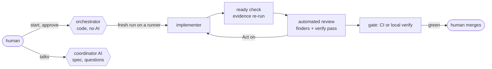

# agent-factory

[](https://github.com/chiyanram/agent-factory/actions/workflows/ci.yml)
[](LICENSE)

A software factory for your own repos: AI runs build and review a ticket's pull request, and a human approves and
merges it.



## What it is

- **Code decides each step.** The orchestrator follows a fixed table; no model chooses what runs next.
- **Every run is fresh** and runs on a runner (`srt` on a laptop, or a Sysbox container on a VM), with no git host
  login. The host pushes and posts for it.
- **A human owns the gates.** A human STARTs each ticket, approves the spec above the tiny lane, and merges. The AI
  never approves, and zero findings is not a pass.
- **Standards plug in** from a pinned Claude Code plugin, such as `rulebook@chiyanram`
  ([chiyanram/skills](https://github.com/chiyanram/skills)), and from the project's own `AGENTS.md`.

## Who it is for, and what it is not

For a developer or a small team who wants agent-built pull requests on their own GitHub or GitLab repos, with each
run sandboxed and capped. It is not a hosted service, not always on (nothing runs until a human starts a ticket), and
not a merge bot. Today the runs need a Claude plan; Copilot is #162.

## Install and set up

You need Node 22 or later, git and the Claude Code CLI. Install a pinned release, then run `init` in your clone:

```bash
V=0.30.1
npm i -g https://github.com/chiyanram/agent-factory/releases/download/v$V/chiyanram-agent-factory-$V.tgz
cd ~/workspace/<your clone> && agent-factory init     # Enter takes the recommended choices
```

`init` writes the settings outside the repo, pins the plugins, checks each piece and prints the commands only you run
next. The manual steps are in [docs/how-to/](docs/how-to/).

## Your first ticket

1. `agent-factory coordinator [<project>]`: talk the ticket through; the coordinator writes the spec. It reads the
   project's git host and clone from the project file `init` wrote, so it needs no shell exports.
2. `agent-factory start <project> <ticket>`; above the tiny lane, also `agent-factory approve`.
3. The orchestrator loop builds, checks and reviews the pull request, then pings you to merge.

## Status

A pilot on one small personal project (#62). The code does not follow the design everywhere yet; each place that
differs is marked **Today:** in the docs, and [the roadmap](docs/explanation/roadmap.md) lists what is still to build.

## Docs

- [docs/how-to/](docs/how-to/): install, set up, check the runner.
- [docs/reference/](docs/reference/): the commands, the settings and the connectors.
- [docs/explanation/](docs/explanation/): the architecture, the safety model, measurement and the roadmap.
- [CONTRIBUTING.md](CONTRIBUTING.md) · [AGENTS.md](AGENTS.md) · [docs/adr/](docs/adr/) · [GLOSSARY.md](GLOSSARY.md)

## License

[MIT](LICENSE)
