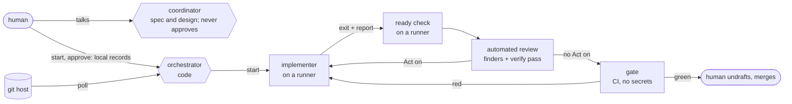
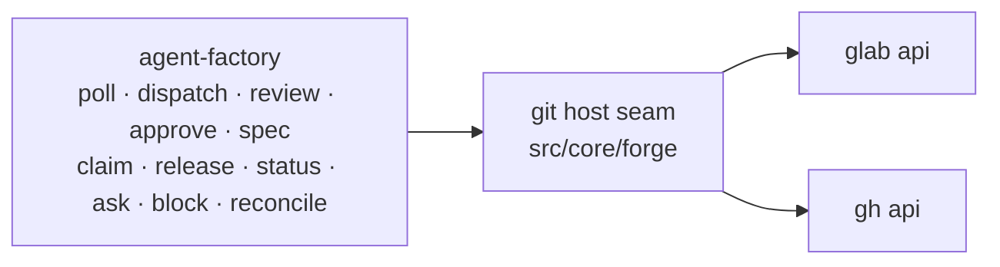

# agent-factory

[](https://github.com/chiyanram/agent-factory/actions/workflows/ci.yml)
[](LICENSE)

AI implementer and automated review runs on your pull requests, while humans keep approval and merge.

## What it is

You talk to one coordinator AI. An orchestrator (code, no LLM) takes each ticket a human STARTed or approved and gets
its pull request built, reviewed and gate-green by fresh AI runs, each on a runner. Then a human merges it. The git host
(GitLab or GitHub) and the run records hold every piece of state, so a restart loses nothing.

- **Humans keep the gates.** A human approves before any code, and a human merges. The bot cannot merge.
- **Code starts runs, not the AI.** The coordinator talks with you; it holds no git host login and starts no run.
- **Runs execute on a runner.** No git host token, no network except the model API and package registries. The host
  pushes.
- **Fresh runs.** Each task starts a new run, so no run drifts or forgets its instructions.
- **Automated review, two steps.** A finder run per lens lists findings; a verify pass drops what does not hold. It
  may block, never approve.
- **Rules from the default branch.** A pull request cannot change the rules it is judged by.

> **Status (2026-11-09).** The TypeScript package runs the orchestrator, the implementer in a runner, the host push,
> the ready check, the automated review and the local gate. The design on one page, with what is still to build and the
> order, is [docs/DESIGN.md](docs/DESIGN.md); its words are in [GLOSSARY.md](GLOSSARY.md). Map #30 tracks the work.
> The first pilot is a small personal project on the VM (#62).

The rules the runs follow live in the `rulebook` plugin in [chiyanram/skills](https://github.com/chiyanram/skills)
and in each project's own `AGENTS.md` files, not here.

## Quick start

You need Node 22 or later, git, make and the Claude Code CLI. Check the package:

```bash
git clone https://github.com/chiyanram/agent-factory.git
cd agent-factory
make lint && make test
```

Point the coordinator at a project. First set up its identity ([GUIDE.md](GUIDE.md#set-up-identity)), then:

```bash
export FACTORY_FORGE=gitlab              # the git host: gitlab or github
export FACTORY_PROJECT=group/project     # the GitLab project path, or owner/repo on GitHub
export FACTORY_REPO=~/src/project        # a local clone of it
export FACTORY_RULEBOOK=<rulebook plugin folder>
npx agent-factory poll                   # one line of facts per open PR
```

Then start the coordinator (`agent-factory coordinator`) and follow [GUIDE.md](GUIDE.md#run-the-loop). The orchestrator
loop (`agent-factory dispatch <project>`) runs the trigger table; `agent-factory start` and `approve` start it.

## How it works



1. A human STARTs the ticket (`agent-factory start`), and, above the tiny lane, approves its spec and design
   (`agent-factory approve`) in their own terminal. The coordinator can run neither. A `/approved` note on the PR
   approves nothing.
2. The orchestrator claims the PR and starts a fresh **implementer** run on a runner, in its own clone.
3. The implementer commits, writes `.factory/report.json` (done, asked or blocked) and exits. The host checks it, pushes and
   posts it.
4. A ready check re-runs the evidence. Then a fresh **automated review** posts a verdict, plus a script-made list of
   protected files and new dependencies.
5. The implementer fixes what the review marks **Act on**. After three rounds, a human decides.
6. When the gate is green, a human reads that list, undrafts and merges. Zero findings is never a pass.



The orchestrator decides from its table (`src/core/dispatch/table.ts`); the coordinator only talks, asks and writes
the spec. Every command prints one line. Every call to the git host goes through one seam, so the commands do not know
which git host they talk to. The tests stub the seam and the `claude` CLI, so they need no network.

## Docs

- [GUIDE.md](GUIDE.md): set up the bot, the settings, run the loop, the guardrails and the terms.
- [CONTRIBUTING.md](CONTRIBUTING.md): set up, test, add a script or a check, commit messages.
- [AGENTS.md](AGENTS.md): instructions for coding agents that work in this repo.
- [docs/adr/](docs/adr/): the decisions behind the design.

## License

[MIT](LICENSE)
