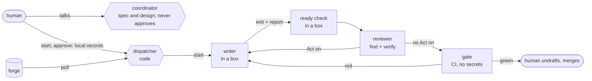

# agent-factory

[](https://github.com/chiyanram/agent-factory/actions/workflows/ci.yml)
[](LICENSE)

AI writers and reviewers on your merge requests, while humans keep approval and merge.

## What it is

You talk to one coordinator AI. A dispatcher (code, no LLM) takes each approved merge request and gets it written,
reviewed and gate-green by fresh AI workers in a box. Then a human merges it. The forge (GitLab or GitHub) holds
every piece of state, so a restart loses nothing.

- **Humans keep the gates.** A human approves before any code, and a human merges. The bot cannot merge.
- **Code dispatches, not the AI.** The coordinator talks with you; it holds no forge login and starts no worker.
- **Workers run in a box.** No forge token, no network except the model API and package registries. The host pushes.
- **Fresh workers.** Each job starts a new session, so no worker drifts or forgets its instructions.
- **One reviewer, two passes.** A find pass lists findings; a verify pass drops what does not hold. It may block,
  never approve.
- **Rules from the default branch.** A merge request cannot change the rules it is judged by.

> **Status (2026-11-09).** The TypeScript package runs the orchestrator, the implementer in a runner, the host push,
> the ready check, the automated review and the local gate. The design on one page, with what is still to build and the
> order, is [docs/DESIGN.md](docs/DESIGN.md); its words are in [GLOSSARY.md](GLOSSARY.md). Map #30 tracks the work.
> The first pilot is a small personal project on the VM (#62).

The rules the workers follow live in the `rulebook` plugin in [chiyanram/skills](https://github.com/chiyanram/skills)
and in each project's own `AGENTS.md` files, not here.

## Quick start

You need bash, git, jq and the Claude Code CLI. Check the scripts:

```bash
git clone https://github.com/chiyanram/agent-factory.git
cd agent-factory
make lint && make test
```

Point the coordinator at a project. First set up its identity ([GUIDE.md](GUIDE.md#set-up-identity)), then:

```bash
export FACTORY_FORGE=gitlab              # or github
export FACTORY_PROJECT=group/project     # the GitLab project path, or owner/repo on GitHub
export FACTORY_REPO=~/src/project        # a local clone of it
export FACTORY_RULEBOOK=<rulebook plugin folder>
npx agent-factory poll                   # one line of facts per open merge request
```

Then start a Claude Code session in this repo and tell it to run the loop in [GUIDE.md](GUIDE.md#run-the-loop).
Until the dispatcher exists, you or the coordinator run the trigger table by hand.

## How it works



1. A human STARTs the ticket (`agent-factory start`), and, above the tiny lane, approves its spec and design
   (`agent-factory approve`) in their own terminal. The coordinator can run neither. A `/approved` note on the MR
   approves nothing.
2. The dispatcher claims the MR and starts a fresh **writer** in a box, in its own worktree.
3. The writer commits, writes `.factory/report.json` (done, asked or blocked) and exits. The host checks it, pushes and
   posts it.
4. A ready check re-runs the evidence. Then a fresh **reviewer** posts a verdict, plus a script-made box of protected
   files and new dependencies.
5. The writer fixes what the reviewer marks **Act on**. After three rounds, a human decides.
6. When the gate is green, a human reads the box, undrafts and merges. Zero findings is never a pass.


Today the coordinator decides and the scripts act. In the target design the dispatcher decides from `poll` and the
coordinator only talks, asks and approves. Every script prints one line. Every call to the forge goes through one
seam, so the loop scripts do not know which forge they talk to. The tests stub the seam and the `claude` CLI, so they
need no network.

## Docs

- [GUIDE.md](GUIDE.md): set up the bot, the settings, run the loop, the guardrails and the terms.
- [CONTRIBUTING.md](CONTRIBUTING.md): set up, test, add a script or a check, commit messages.
- [AGENTS.md](AGENTS.md): instructions for coding agents that work in this repo.
- [docs/adr/](docs/adr/): the decisions behind the design.

## License

[MIT](LICENSE)
