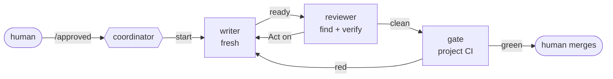
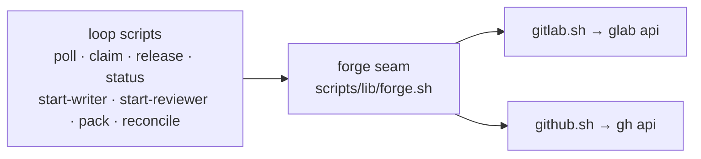

# agent-factory

[](https://github.com/chiyanram/agent-factory/actions/workflows/ci.yml)
[](LICENSE)

AI writers and reviewers on your merge requests, while humans keep approval and merge.

## What it is

One coordinator AI takes an approved merge request and gets it written, reviewed and gate-green by fresh AI workers.
Then a human merges it. The coordinator runs a small set of bash scripts. The forge (GitLab or GitHub) holds every
piece of state, so a restart loses nothing.

- **Humans keep the gates.** A human posts `/approved` before any code, and a human merges. The bot cannot merge.
- **Fresh workers.** Each job starts a new session, so no worker drifts or forgets its instructions.
- **One reviewer, two passes.** A find pass lists findings; a verify pass opens each one and drops what does not hold.
- **Rules from the default branch.** A merge request cannot change the rules it is judged by.

The rules the workers follow live in the `rulebook` plugin in [chiyanram/skills](https://github.com/chiyanram/skills)
and in each project's own `AGENTS.md` files, not here.

## Quick start

You need bash, git, jq and the Claude Code CLI. Check the scripts:

```bash
git clone https://github.com/chiyanram/agent-factory.git
cd agent-factory
make lint && make test
```

Point the coordinator at a project. First set up its bot ([GUIDE.md](GUIDE.md#set-up-the-bot)), then:

```bash
export FACTORY_FORGE=gitlab              # or github
export FACTORY_PROJECT=group/project     # the GitLab project path, or owner/repo on GitHub
export FACTORY_REPO=~/src/project        # a local clone of it
export FACTORY_RULEBOOK=<rulebook plugin folder>
scripts/poll.sh                          # one line of facts per open merge request
```

Then start a Claude Code session in this repo and tell it to run the loop in [GUIDE.md](GUIDE.md#run-the-loop).

## How it works



1. A human posts `/approved` on a draft MR whose description holds the intent and the acceptance criteria.
2. The coordinator claims the MR and starts a fresh **writer** in its own worktree.
3. A fresh **reviewer** checks the change against the rules and posts a verdict on the MR.
4. The writer fixes what the reviewer marks **Act on**. After three rounds, a human decides.
5. When the gate is green and nothing is open, a human merges.



The coordinator decides; the scripts act. Every script prints one line. Every call to the forge goes through one
seam, so the loop scripts do not know which forge they talk to. The tests stub the seam and the `claude` CLI, so they
need no network.

## Docs

- [GUIDE.md](GUIDE.md): set up the bot, the settings, run the loop, the guardrails and the terms.
- [CONTRIBUTING.md](CONTRIBUTING.md): set up, test, add a script or a check, commit messages.
- [AGENTS.md](AGENTS.md): instructions for coding agents that work in this repo.
- [docs/adr/](docs/adr/): the decisions behind the design.

## License

[MIT](LICENSE)
